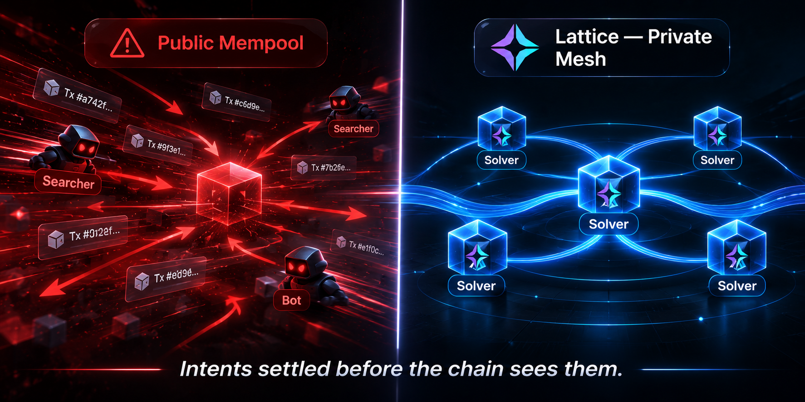
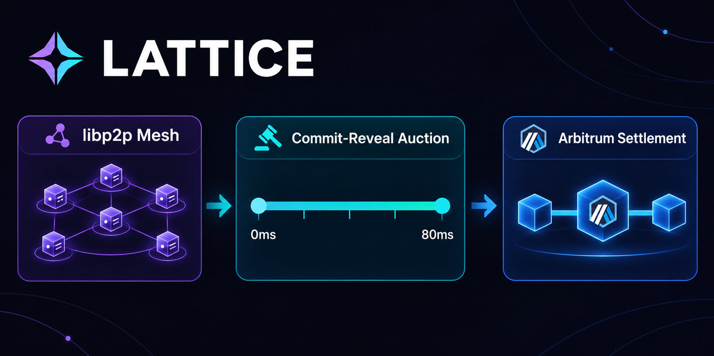
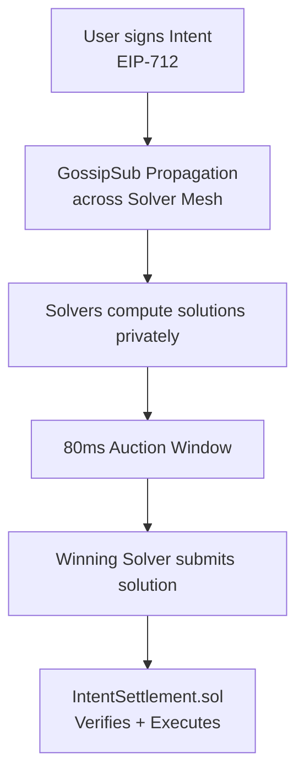

<div align="center">
        
# Lattice

**Private solver mesh powered by Js-libp2p. Intents settled before the chain sees them.**

<p align="center">
  <a href="#"></a>
  <a href="#"></a>
  <a href="#"></a>
  <a href="#"></a>
</p>

<div align="center">

</div>

</div>


# Intro

**Lattice** is an **intent-based DeFi coordination layer** built on **js-libp2p**.  

Users sign what they want. Solvers compete **privately** to fill it. The best solution lands on-chain. 

**No public-mempool exposure. The signed bid is the on-chain floor.**


> It earns the name on three levels — gossip (GossipSub is the propagation engine), lattice as in ultra-fine mesh fabric (the solver subnet topology), and the connotation of something fast and nearly invisible.

> That last part is exactly what good infrastructure feels like.


# The problem it solves

- Modern DeFi leaks intent data too early. The moment a swap hits a public RPC or mempool, searchers can front-run it. Existing solver networks patch this with centralized off-chain APIs — which defeats the point.

- Lattice moves coordination entirely peer-to-peer: intents propagate through an encrypted solver mesh, solvers bid in a sealed commit-reveal auction (80ms target window), and only the winning solution touches the chain.

<div align="center">
  
</div>


# DEMO

<!--old [Watch Demo](https://teal-secondary-antelope-34.mypinata.cloud/ipfs/bafybeief2j7zoo4dw4czinwzaumgfyzahwex5vjmny2a4gbrpcfidmgohe) -->

[Lattice Demo](https://www.loom.com/share/4de26082a5fa42618fb46853baf4c6d5)


> The demo runs three local node processes (two workers and a coordinator) plus a user script against **Arbitrum One**. The user signs an EIP-712 intent, the mesh runs a sealed commit-reveal auction, and the winning solver submits `settle()` through Uniswap v3. Every step is logged in the terminal, ending in an Arbiscan tx link.

**Mainnet settle:** [`0x66fdef7c…cb4f1`](https://arbiscan.io/tx/0x66fdef7cb26c6e2f603b4590c3776854b1b5ec45e3a7c4e57f18322ce12cb4f1#statechange) — USDC in, WETH out, at or above the signed bid.

<div align="center">
  <table>
    <tr>
      <td align="center">
        
        <!-- <br><strong>js-libp2p Powered</strong> -->
      </td>
      <td align="center">
        
        <!-- <br><strong>Lattice Mesh Demo</strong> -->
      </td>
    </tr>
  </table>
</div>

## How it works

<div align="center">
  
</div>



- The _Networking_ layer is **js-libp2p** — Noise-encrypted connections, yamux multiplexing, Kademlia DHT for discovery, GossipSub for intent propagation. 
- The _Trust_ layer is **EVM** — solver stake with pull withdrawal, and on-chain settlement of EIP-712 signatures. The signed bid is the swap floor.
- The _Coordinator_ is a relay and auctioneer: it can censor an intent but cannot lower a signed bid or move user funds.


## Architecture at a glance

| Layer | Component | Role |
|---|---|---|
| Transport | WebSocket + Noise XX + yamux | Encrypted, multiplexed peer connections |
| Discovery | Kademlia DHT + Bootstrap | Solvers find each other at startup |
| Propagation | GossipSub (2 topic tiers) | Intent gossip — public and tier-1 meshes |
| Validation | Topic validators | Sig check + deadline + registry, ~1.3ms |
| Negotiation | `/defi/rfq/1.0.0` streams | Direct solver-to-solver bid exchange |
| Settlement | `IntentSettlement.sol` | Verify both signatures, `SwapRouter.exactInput` with `amountOutMinimum = bid.outputAmount`. User receives at least that bid. Solver fee is 5% of surplus above it. |
| Trust anchor | `SolverRegistry.sol` | Stake, register, `deregister` credits a pending balance, `withdraw()` pulls it. PeerID ↔ EVM binding. |


## Latency budget (80ms target window)

```
Intent propagation to solvers     10–20ms
Solver pathfinding + compute      20–40ms
Bid return to coordinator         10–20ms
Auction resolution                 5–10ms
Buffer                            10–15ms
─────────────────────────────────────────
Total                             ~80ms
```

Pre-warmed libp2p connections reduce dial time from ~50ms cold to ~2ms. Measured locally the commit-reveal round takes about 1–2s (`COMMIT_WINDOW_MS=2000`, compute + EIP-712 signing); the 80ms figure is the design target, not a measured result.


## Roadmap

### Phase 1 — Foundation
- [x] **1.1** js-libp2p solver node — Noise, yamux, WebSocket, GossipSub, DHT
- [x] **1.2** Peer discovery — bootstrap list, Kademlia DHT, connection pre-warming
- [x] **1.3** `SolverRegistry.sol` — stake, register, pull withdrawal, PeerID → EVM address binding

### Phase 2 — Intent Gossip & Validation
- [x] **2.1** Intent schema — EIP-712 typed struct, protobuf wire format, `intentId` as GossipSub `messageId`
- [x] **2.2** GossipSub topology — 2-tier topic routing (`public` / `tier-1`), mesh tuned for sub-100ms
- [x] **2.3** Validation pipeline — sig verify → deadline → registry cache (60s TTL + event invalidation)

### Phase 3 — Solver RFQ & Auction Engine
- [x] **3.1** `/defi/rfq/1.0.0` stream protocol — direct encrypted solver negotiation, sealed bids
- [x] **3.2** Auction coordinator — 80ms hard deadline, `Promise.race`, parallel RFQ broadcast
- [x] **3.3** Solver compute engine — DEX pathfinding (Uniswap v3 / Curve), route encoding

### Phase 4 — EVM Settlement & Incentives
- [x] **4.1** `IntentSettlement.sol` — verify EIP-712 intent + bid, execute the route at the signed output, pay the user at least that bid
- [x] **4.2** Solver incentive model — 5% of surplus above the signed bid; stake exits through `withdraw()`; fills drive tier. A fill below the bid reverts and does not burn the nonce.

### Phase 5 — Hardening & Launch
- [ ] **5.1** Latency benchmarking harness — per-hop timing, p99 profiling, geo simulation
- [x] **5.2** MEV resistance — commit-reveal auction (`libp2p/commitment.js`); `settle` reverts below `bid.outputAmount`
- [x] **5.3** Audit remediation (H-1 → L-5, tracked in `contracts/issues/`) — 48 Foundry tests passing
- [x] **5.4** Arbitrum One deployment — verified contracts, Gnosis Safe treasury
- [ ] **5.5** Recorded live mainnet mesh run (2 solvers, QuoterV2, Uniswap v3)


## Design decisions (locked)

| Decision | Choice | Rationale |
|---|---|---|
| Partial fills | No (v1) | Complexity without volume justification |
| Auction window | Protocol-fixed 80ms | Users can't reason about latency |
| Solver nodes | Server-only (always-on) | Browsers can't hit sub-100ms reliably |
| Topic tiers | 2 (public + tier-1) | Single leaks; 3 premature pre-scale |
| Registry check | Cache + event invalidation | Fresh RPC (50–200ms) kills budget |

---

## Live on Arbitrum One

| Contract | Address |
|---|---|
| `IntentSettlement` | [`0xdaB66B53c1041Ac60cD238beAe885f8741415025`](https://arbiscan.io/address/0xdaB66B53c1041Ac60cD238beAe885f8741415025) |
| `SolverRegistry` | [`0x469e747e4bEe661989DC7b1C988E0fBC87d5826d`](https://arbiscan.io/address/0x469e747e4bEe661989DC7b1C988E0fBC87d5826d) |
| Treasury (Gnosis Safe, immutable) | [`0x3404F333B92DD849819F3C03e0eF18ec1035Dd6f`](https://arbiscan.io/address/0x3404F333B92DD849819F3C03e0eF18ec1035Dd6f) |

| Uniswap v3 dependency | Address |
|---|---|
| SwapRouter | `0xE592427A0AEce92De3Edee1F18E0157C05861564` |
| QuoterV2 | `0x61fFE014bA17989E743c5F6cB21bF9697530B21e` |
| USDC (native) / WETH | `0xaf88d065e77c8cC2239327C5EDb3A432268e5831` / `0x82aF49447D8a07e3bd95BD0d56f35241523fBab1` |

| Parameter | Value |
|---|---|
| Tier-0 stake | 0.05 ETH |
| Tier-1 stake | 0.5 ETH and 10 fills |
| Solver fee | 5% of surplus above the signed bid (`SOLVER_FEE_BPS = 500`) |
| Swap floor | `amountOutMinimum = bid.outputAmount` |
| Mainnet settle | [`0x66fdef7c…cb4f1`](https://arbiscan.io/tx/0x66fdef7cb26c6e2f603b4590c3776854b1b5ec45e3a7c4e57f18322ce12cb4f1#statechange) |

How the contracts behave:

- `settle` reverts with `Output below bid` if the swap returns less than the signed bid, and the nonce stays unused.
- A user cancels outstanding signatures with `invalidateNonce()`.
- `deregister()` credits `pendingWithdrawals`; the solver claims it with `withdraw()`.
- Standard ERC-20s only. Fee-on-transfer and rebasing tokens revert.

---

## Run the mesh (end to end)

Flow: **user** (`scripts/run-user.js`) → GossipSub → **coordinator** (`scripts/run-solver.js`) → RFQ to **workers** → winner submits **`IntentSettlement.settle`**.

### Environment (repo-root `.env`)

```bash
PRIVATE_KEY=0x...
ARB_SEPOLIA_RPC=https://arb-mainnet.g.alchemy.com/v2/YOUR_KEY   # legacy variable name, any Arbitrum RPC
ARB_SEPOLIA_CHAIN_ID=42161                                      # or CHAIN_ID; 421614 for Arbitrum Sepolia

SETTLEMENT_CONTRACT_ADDRESS=0xdaB66B53c1041Ac60cD238beAe885f8741415025
REGISTRY_CONTRACT_ADDRESS=0x469e747e4bEe661989DC7b1C988E0fBC87d5826d

USE_QUOTER=1                # QuoterV2 for honest bids (adds ~10-30ms)
SETTLE_QUOTER_CHECK=1       # preflight: refuse to settle if the quote is below the bid
SOLVER_MARGIN_BPS=10        # shade bids for heterogeneity (set per worker)
# RFQ_DIAL_TIMEOUT_MS=60
```

`run-user.js`, `run-solver.js` and the bench scripts ship defaults for chain 42161 (USDC → WETH) and chain 421614.

### One-time per user wallet

`settle()` pulls the input token with `transferFrom`, so approve a small allowance first (2 USDC here):

```bash
cast send 0xaf88d065e77c8cC2239327C5EDb3A432268e5831 \
  "approve(address,uint256)" $SETTLEMENT_CONTRACT_ADDRESS 2000000 \
  --rpc-url "$ARB_SEPOLIA_RPC" --private-key "$PRIVATE_KEY"
```

Revoke after testing: same call with amount `0`.

### Register solvers (once each)

```bash
REGISTER_ACTION=peer-id SOLVER_INDEX=1 node scripts/register-solver.js              # print the stable PeerID
SOLVER_INDEX=1 PEER_ID=<peerId> node scripts/register-solver.js                      # stake 0.05 ETH, tier 0
REGISTER_ACTION=deregister SOLVER_INDEX=1 node scripts/register-solver.js            # credits stake, then withdraw()
REGISTER_ACTION=withdraw   SOLVER_INDEX=1 node scripts/register-solver.js            # retry withdraw only
```

### Run the solver (single node)

```bash
node scripts/run-solver.js   # logs PeerID and multiaddr for the user's BOOTSTRAP_PEERS
```

With `SETTLEMENT_CONTRACT_ADDRESS` set and `AUTO_SETTLE` not `false`, the winning bid auto-submits on-chain.

### Run the user

```bash
BOOTSTRAP_PEERS=/ip4/127.0.0.1/tcp/9000/ws/p2p/<coordinatorPeerId> \
INPUT_AMOUNT=1000000 MIN_OUTPUT=<min WETH wei> \
  node scripts/run-user.js
```

The user reads `settlement.nonces(wallet)` to sign the correct nonce. Set `MIN_OUTPUT` below the live QuoterV2 quote or no solver can bid.

### Which settlement contract

| Goal | Contract | Notes |
|---|---|---|
| Real swap on Arbitrum One | **`IntentSettlement`** | Uniswap v3 via SwapRouter, QuoterV2 bids. This is the demo path. |
| Testnet without pool liquidity | **`MockIntentSettlement`** | Same signing, nonce and tier checks, no SwapRouter call. Deploy with `deployMock(address)` ([`contracts/README.md`](contracts/README.md)). |
| Mesh evidence | 2–3 solvers | Different `SOLVER_PORT`, shared `BOOTSTRAP_PEERS`. One solver plus one user is a valid RFQ test, not a mesh. |

### Troubleshooting

| Error | Cause | Fix |
|---|---|---|
| `bad address checksum` | Token address with wrong letter case | Use the checksummed addresses above |
| `Output below bid` / `quoter.below-bid` | Live Uniswap quote is under the signed bid | Lower `MIN_OUTPUT` or raise `SOLVER_MARGIN_BPS` shading; nonce is not burned |
| `Nonce mismatch` | Intent signed with a stale nonce | Re-run `run-user.js` |
| `transferFrom` reverts | No USDC allowance or balance | Run the approval above; check balance |
| `Solver not registered` | Wallet not in registry | `node scripts/register-solver.js` |
| `Nothing to withdraw` | No pending stake | Call `deregister` first |
| `execution reverted (no data)` on `nonces()` | Settlement contract lacks the passthrough (pre-v1.1) | Use the current deployment |
| `Method disabled` on `eth_newFilter` | Old registry-cache build on a restricted RPC | Fixed: registry events are read with `eth_getLogs` |
| `Block range is too large` | RPC `eth_getLogs` limit | Poll window is capped at 2000 blocks; lower it if your RPC is stricter |
| HTTP 429 from RPC | Rate limited | Use a keyed RPC; raise `RPC_429_EXTRA_MS` |

### Operations notes

Public gateways aggressively **429** rate-limit. **Prefer a keyed provider** (Alchemy / Infura / QuickNode).

The repo configures a gentler ethers client in **[`node/rpc-provider.js`](node/rpc-provider.js)** (`batchMaxCount=1`, tunable **`RPC_POLLING_INTERVAL_MS`**, **`RPC_429_EXTRA_MS`** default long sleep on HTTP 429). **`submitSettlement`** wraps critical calls in **back-off retries**.

If logs show **`settle revert`** with **`require(false)`** or a selector-only hex, the chain often surfaced **no `Error(string)`** — commonly **`SwapRouter.exactInput`** (path / liquidity / token quirks), not gossip. Use **`cast call … settle.staticCall`** (or Tenderly) to isolate. Set **`SETTLE_GAS_LIMIT`** (e.g. `800000`) to skip **`estimateGas`** after a successful **`staticCall`**.

Mesh and signing can succeed while **`settle` fails**; those are separate layers (P2P vs EVM infra).

---

## Learn-Test-and-Fix

Bring-up log for the multi-solver mesh. The reference run below was recorded on **Arbitrum Sepolia** with `MockIntentSettlement`; mainnet uses the same code path with `IntentSettlement`.

### Is commit-reveal doing what we think?

**Yes.** Solvers hash `keccak256(intentId, outputAmount, routeHash, salt)` in phase 1 and only reveal the full bid in phase 2. A solver cannot change its quote after seeing a competitor's bid — it can only reveal what it committed to at t=0. That is the anti-sniping property; your logs show it working:

```
[auction] … — commit-reveal with 2 remote solver(s)
[commit] phase 1 done — 2 commitments in 1205ms
[commit] phase 2 done — 2 reveals in 1209ms
[auction] … — closed at 1209ms, 2 bid(s)
```

Streams are **Noise XX + yamux** over WebSocket (`/defi/rfq/1.0.0`); bids never touch public mempool.

### Multi-solver mesh — working?

**Functionally yes; latency not production-tight yet.**

| Check | Status | Evidence |
|---|---|---|
| 3-node topology (coordinator + 2 workers) | OK | `worker links 2/2 (2 inbound, 2 outbound dial)` |
| Gossip intent → coordinator auction | OK | User publish → `[auction] commit-reveal with 2 remote solver(s)` |
| Both workers bid | OK | `2 commitments`, `2 reveals`, `2 bid(s)` |
| Winner selection | OK | `winner: solver 0xbbb6f72686…` |
| On-chain settle (mock) | OK | Worker 2: `[settle] tx: …/0xf75e48ca…` confirmed block 270795168 |
| 80ms auction budget | **Not yet** | ~**1.2s** round-trip (local dev; `COMMIT_WINDOW_MS=2000`, compute + EIP-712 sign) |
| Bid heterogeneity | Weak | Both workers quoted identical `54238200487945951` — set `SOLVER_MARGIN_BPS` **per worker** to differentiate |

**Verdict:** Lattice private mesh + commit-reveal auction + remote winner settle was **E2E proven** on Sepolia (reference run). Optimize latency and bid diversity before calling it production-efficient.

### Issues and fixes (chronological)

- **Solo mesh only (`solverPeers: []`)** — Coordinator never RFQ'd workers. Added `SOLVER_PEER_ADDRS`, `AUCTION_ROLE=coordinator|worker`, commit-reveal RFQ on workers.
- **PeerID mismatch after restart** — Random libp2p keys changed every boot; coordinator dialed stale IDs → RFQ timeout. Persist keys in `.lattice/libp2p-keys/<evm-address>.key`; register **after** first boot. `REGISTER_ACTION=deregister` credits stake and `register-solver.js` then calls `withdraw()` before any `peer-id` re-registration.
- **`multiaddr().getPeerId is not a function`** — libp2p v3 API change. Parse `/p2p/` via `getComponents()`.
- **`pre-warmed 0/2` / "workers not listening"** — Misleading: workers connect **inbound**; outbound dial can fail while links are fine. Log `worker links N/M (inbound, outbound)`; poll up to 30s.
- **Port 9001 `EADDRINUSE`** — Stale node process. Clear with `lsof -ti :9001 | xargs kill`; clearer error in `node/solver.js`.
- **`stream.sink is not a function`** — libp2p v3 uses `stream.send()`, not it-pipe `sink`. Updated `rfq-internal.js`.
- **`Stream ended after 1 bytes, expected 4`** — Async iteration on v3 streams is wrong; reads must use `@libp2p/utils` **`byteStream()`** (message events).
- **`commit response timeout (300ms)`** — Window too tight for local compute + sign. Default `COMMIT_WINDOW_MS=2000`, `REVEAL_WINDOW_MS=1000`.
- **RFQ handler signature** — libp2p v3 handler is `(stream, connection)`, not `({ stream, connection })`.
- **`eth_newFilter` / `Method disabled` flood** — ethers `.on()` needs filters that many RPCs reject. `libp2p/registry-cache.js` now polls `eth_getLogs` (2000-block cap) and falls back to the 60s TTL.
- **`bad address checksum`** — a mis-cased WETH constant; all token constants are now checksummed.
- **Preflight L117 invalid bid signature** — Coordinator tried `settle()` with its key while winner was worker `0x9D48…` / `0xbbB6…`. **`msg.sender` must equal `bid.solver`**. Added `/defi/settle-win/1.0.0`: coordinator notifies remote winner; winning worker submits tx (see worker log: `[settle-win] auction won — submitting settle()`).

### Verified E2E log chain (Sepolia reference run)

```
# Coordinator
[auction] commit-reveal with 2 remote solver(s)
[commit] phase 1 done — 2 commitments in 1205ms
[commit] phase 2 done — 2 reveals in 1209ms
[auction] winner: solver 0xbbb6f72686… output: 54238200487945951
[auction] remote winner 0xbbB6F726… — notifying worker to settle
[auction] remote settle complete

# Worker 2 (winner)
[settle-win] auction won — submitting settle()
[settle] tx: https://sepolia.arbiscan.io/tx/0xf75e48caeee42362b83ab7a601692f25a83dca2747583e0330aa7f99613ad020
[settle] confirmed block 270795168; gasUsed 136769
```

### Multi-solver quick start (stable PeerIDs)

```bash
# 1) Workers first (note settle-win handler registered)
SOLVER_INDEX=1 SOLVER_PORT=9001 AUCTION_ROLE=worker BOOTSTRAP_PEERS=/ip4/127.0.0.1/tcp/9000/ws/p2p/<coord> node scripts/run-solver.js
SOLVER_INDEX=2 SOLVER_PORT=9002 AUCTION_ROLE=worker BOOTSTRAP_PEERS=/ip4/127.0.0.1/tcp/9000/ws/p2p/<coord> node scripts/run-solver.js

# 2) Coordinator
PRIVATE_KEY=$PRIVATE_KEY SOLVER_PEER_ADDRS=/ip4/127.0.0.1/tcp/9001/ws/p2p/<w1>,/ip4/127.0.0.1/tcp/9002/ws/p2p/<w2> node scripts/run-solver.js

# 3) User
BOOTSTRAP_PEERS=/ip4/127.0.0.1/tcp/9000/ws/p2p/<coord> node scripts/run-user.js
```

Register workers with persisted PeerIDs: `REGISTER_ACTION=peer-id SOLVER_INDEX=N` then `PEER_ID=… node scripts/register-solver.js`.

---

## Tech stack

| Concern | Choice |
|---|---|
| P2P networking | js-libp2p v3.x |
| Transport | WebSocket (TCP) |
| Encryption | Noise XX |
| Multiplexing | yamux |
| Pub/sub | GossipSub |
| Wire format | Protobuf (protobufjs) |
| EVM signing | ethers v6 (EIP-712) |
| Smart contracts | Solidity 0.8.34  |
| Runtime | Node.js 20+ (ESM) |

---

*Lattice — the mesh is the protocol.*
